

  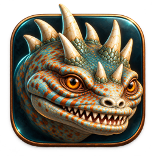

  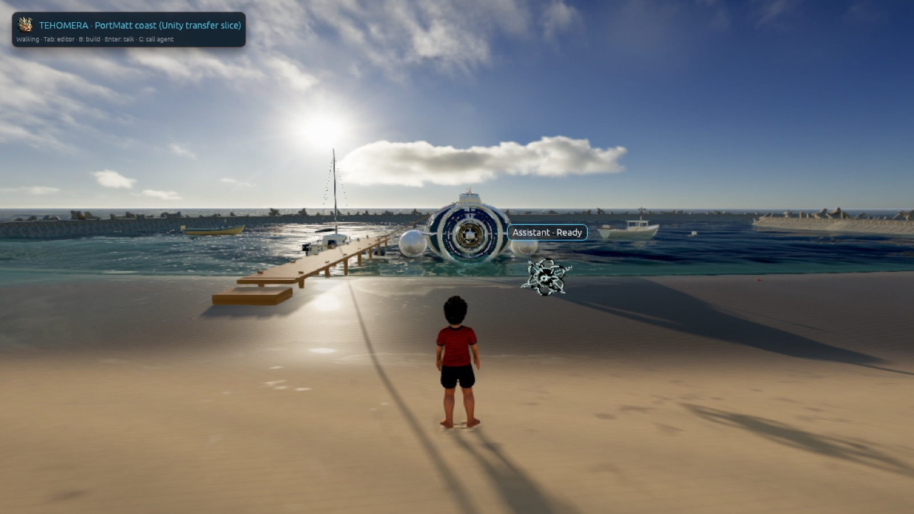

<h1 align="center">Tehomera</h1>

<b>A native 3D world engine where AI agents live <i>inside</i> the world you are building.</b> 
Rust · wgpu/Metal · egui · Rapier physics · glTF + Blender pipeline · Rhai scripting · WGSL shaders · living oceans

---

Most engines bolt an AI chat box onto an editor. In Tehomera the agent has a **body in the scene**. You point at a spot on the beach and ask, and the agent glides there, works with a visible beam, and reports every step the engine confirmed. You can stop it mid-task or undo the whole job in one click. Claude Code, Codex and Grok can each drive an agent today, inside hard limits you control. The provider layer is open, so more AI agents and models can be plugged in over time.

Tehomera Native (v0.5) is a standalone macOS app with about **56,000 lines of Rust** and a test suite for nearly every subsystem. It runs offline, and no browser, server or AI is needed to build worlds by hand.

## See it in motion

  <a href="docs/video/agent-workflow.mp4">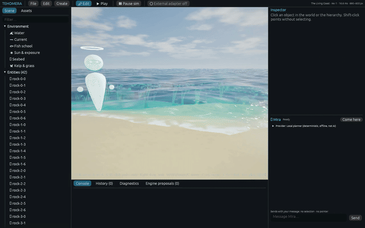</a> 
  An agent at work in the world · <a href="docs/video/agent-workflow.mp4">watch the MP4</a>

  <a href="docs/video/ocean-sunset.mp4">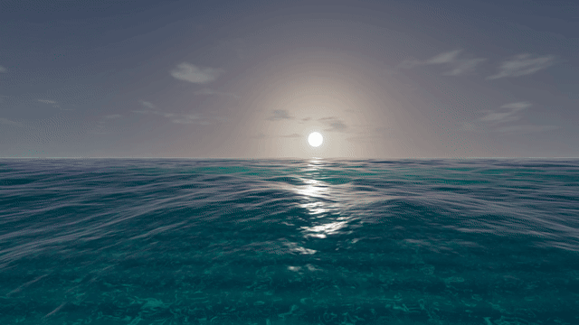</a> 
  The GPU ocean at sunset · <a href="docs/video/ocean-sunset.mp4">MP4</a> · also: <a href="docs/video/coast-gameplay.mp4">PortMatt coast gameplay (24 s)</a>

## What makes it different

| | |
|---|---|
| 🧍 **Embodied agents** | Every agent has an avatar, a name tag and a live status on the map. It travels to your target, shows a work beam, and claims the objects it is editing so you can see who is touching what. |
| 🧾 **Task cards, Stop and Undo group** | Each request becomes a card of engine-confirmed steps (✔/✖, revisions). **Stop** halts immediately and lists what was already applied. **Undo group #N** reverts the entire task as one unit. |
| 🎨 **Agents that build their own tools** | An agent can reshape its own avatar and build you custom in-world control panels (for example *Sea controls*: fish count, waves, predator, "Calm sea"). Those controls are undoable like any other edit. |
| 🤝 **Your choice of model, with consent** | Claude Code, Codex and Grok adapters today (the provider layer is designed so more agents can be added), plus a **deterministic offline planner** that needs no network. Each provider needs explicit, per-provider consent, and every task runs under hard limits (**12 turns, 60 commands, 180 s**). |
| 🛟 **A project system that can't eat your work** | Atomic saves, automatic backups, project locks. Scripts **never run when a project is opened**, and Blender files open with auto-exec disabled. |
| 🌊 **Live editing, even during Play** | The simulation keeps running while you edit. Press Tab to play, then B to keep building in-game. Changes are saved like any edit. |
| 🐟 **Living ecology (MAARAG)** | Habitats, schooling fish and the PortMatt catfish follow juvenile and adult behaviours, and the engine records the reason behind each decision. |

## A look inside

### The PortMatt coast
A full coastal slice carried over from the PortMatt game: sand beach, a marina with quay walls and jetty, breakwaters, boats and the PortMatt submarine. All of it is editable in the engine.

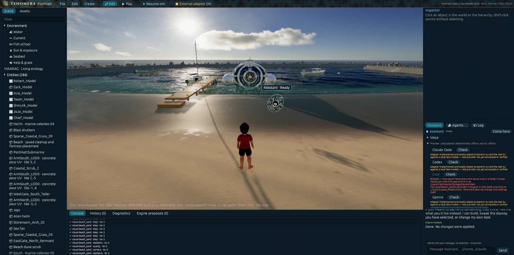

### Agents on the map
Claude, Grok and Codex joined the same world. Each has its own avatar and status, and the provider panel shows each one's consent and connection state. These three are the first; more agents and providers can join the same world as adapters are added.

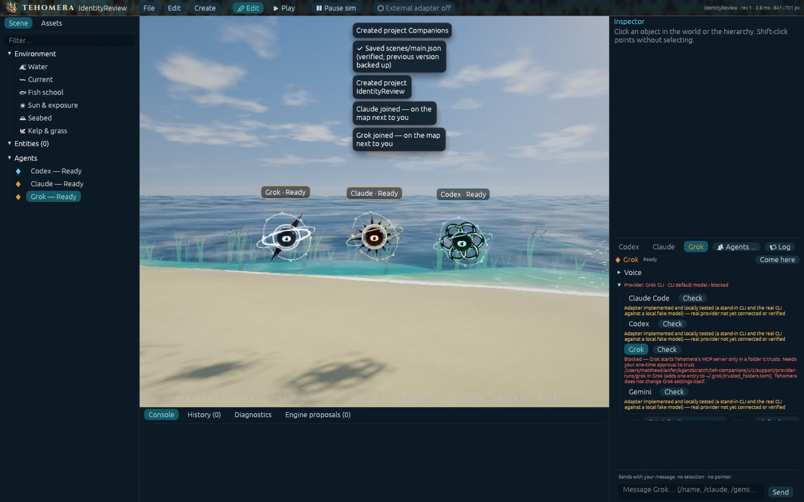

### An agent that redesigns itself and builds you a panel
Asked to *"change how you look and make me some sea controls"*, the agent restyled its avatar and built a **Sea controls** panel. The task card on the right lists every confirmed step, with an **Undo group** button.

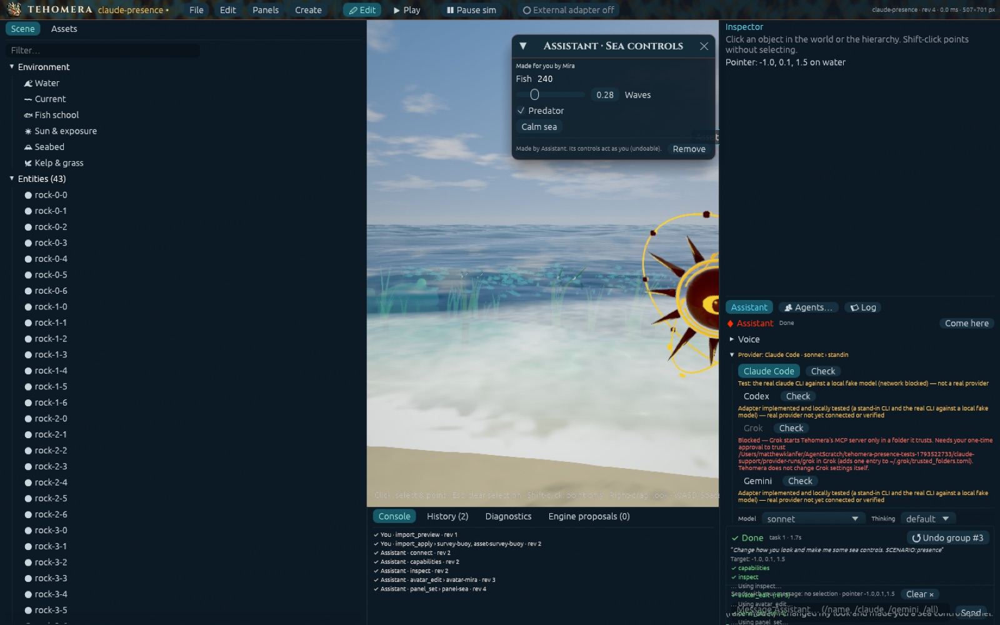

In Play mode the agent-made panel stays live, and the agent can even take a whole new body:

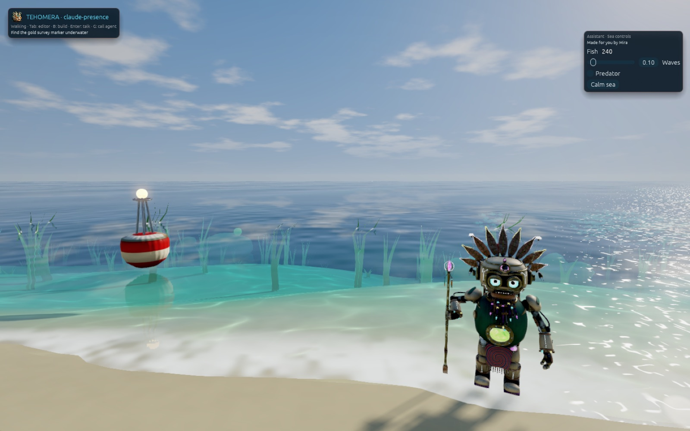

### Projects, agents and conversations
Each project is a real folder with Empty sea, Coast or Lagoon templates. The Agents window lets you name agents, pick their model, and share studio notes that every agent reads.

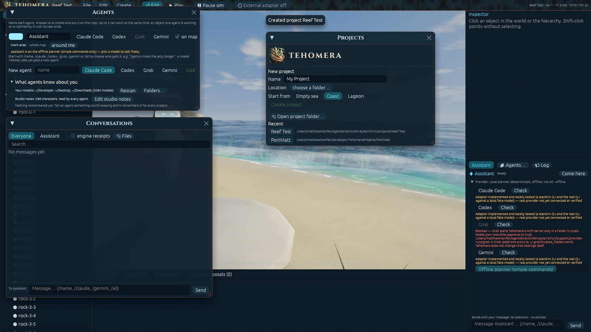

### Water and life
A simulated ocean with waves, current and a reflective surface, plus schools of modelled Mediterranean fish over the seabed.

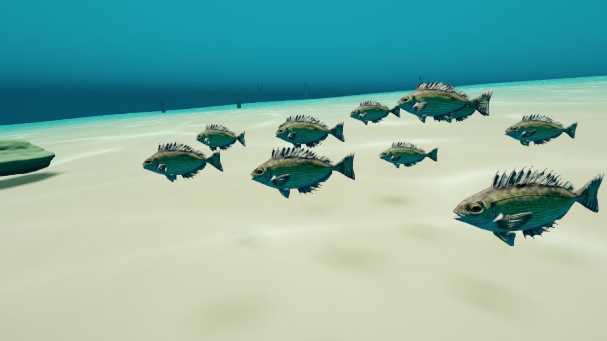
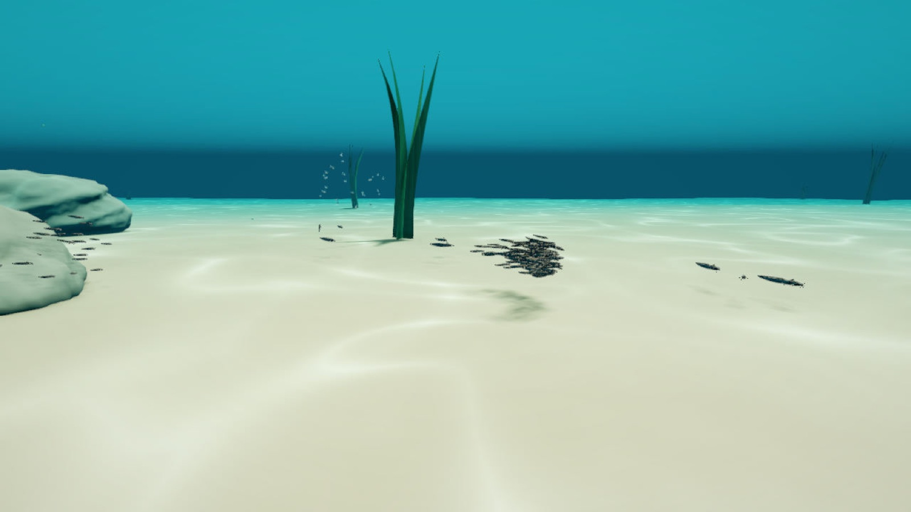

*All images and videos here are real captures from the engine's own automated capture tooling. None are mock-ups.*

## Design

Tehomera has its own visual identity, **Abyss**. It's a deep-ocean theme with dark teal glass panels, Cinzel and Marcellus display type, and the reptile emblem of the "engine of the deep". The same look carries from the splash screen through the world picker to the editor.

<table>
  <tr>
    <td align="center" width="50%">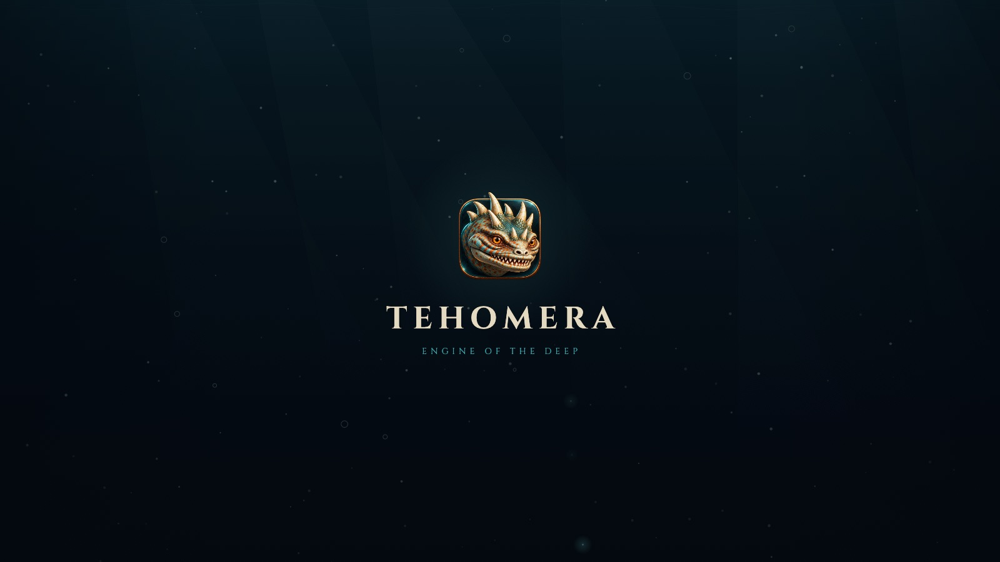 <b>Splash</b> · the emblem rises out of the deep</td>
    <td align="center" width="50%">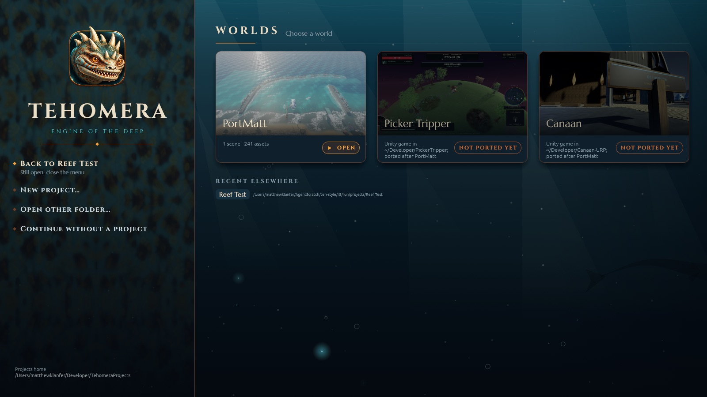 <b>Worlds</b> · start menu with PortMatt, Picker Tripper and Canaan</td>
  </tr>
  <tr>
    <td align="center" width="50%">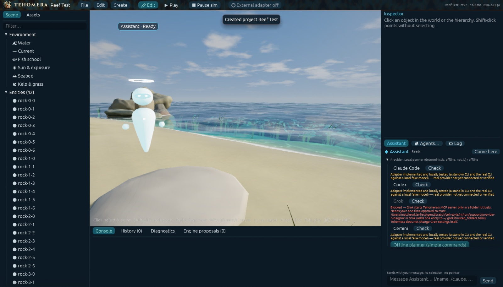 <b>Editor</b> · hierarchy, viewport and agent panel</td>
    <td align="center" width="50%">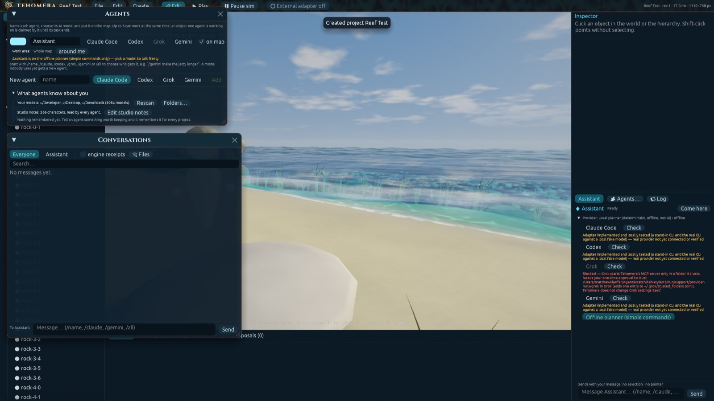 <b>Abyss windows</b> · agents, conversations and projects</td>
  </tr>
</table>

## Feature overview

- **Rendering:** wgpu on Metal, PBR materials, sky and sun exposure, GPU ocean and ripple simulation, sand and terrain sculpting, LOD.
- **Physics:** Rapier 3D bodies and collisions, a player body that walks and swims, and floating objects that ride the shared wave function.
- **Assets:** glTF/GLB import with a preview step (materials, textures, rigs, animation clips, warnings). Content is stored once, addressed by sha256, with provenance. Reimports that would break an instance are flagged.
- **Blender pipeline:** *Assets ▸ From Blender…* runs Blender in the background with a trusted exporter, and writes a provenance report listing anything glTF can't represent.
- **Scripting:** Rhai behaviours (`init` / `update(dt)`) that are bounded per call (operations, 4 ms wall-clock) and hot-reloaded. A failing script is suspended and nothing else stops.
- **Shaders:** custom WGSL material functions inside the PBR pass, validated with naga before any pipeline is built. The last valid shader keeps rendering if a new one fails.
- **Game layer:** Edit/Play toggle, HUD, interactions, build-in-Play toolbar, sound and particles.
- **Editor:** scene hierarchy, inspector, assets, console with engine receipts, attributed history, diagnostics, and engine proposals (build and test before switching).

## Status and honest limitations

Tehomera is an active personal project at **v0.5**, developed on an M4 Mac mini.

- macOS / Apple Silicon only for now.
- Live model providers need their own CLI installed and logged in. Several adapters are verified against stand-in CLIs, and the panel tells you which ones are really connected. The offline planner handles only simple commands.
- glTF covers most needs, but procedural Blender node graphs are not translated, and HLSL/GLSL/ShaderLab shaders are not supported.
- Packaging a finished game as a standalone app for other people is not done yet.

## Source code and access

This repository is a **public showcase**: screenshots, videos and an overview only. The Tehomera source code is **private** and is not published here.

- Interested in early access, a demo build, collaboration or commercial licensing? Open an issue in this repository or contact Matthew Klanfer through GitHub ([@Salvinorin95](https://github.com/Salvinorin95)).
- ⭐ Star or watch this repository to follow development updates.

## License

All images, videos and text in this repository are © 2026 Matthew Klanfer. All rights reserved. See [LICENSE](LICENSE).
